# Highlights

## In short (for people)

16 pictures that show what this fork adds to the redistricting toys: how official congressional maps compare with 10,000 maps drawn without party data, single states drawn six different ways, and the country redrawn as 50 states by who is friends with whom (Meta's Social Connectedness Index). Votes are block-group estimates; official maps are approximated by block-group centres; neutral maps allow a 1% population difference.

More detail: [neutral baselines and true borders](GRAPH_SENSITIVITY.md), [districts drawn by social ties](SCI_DISTRICTS.md), [50 SCI states](SCI_STATES.md), [stronger compactness and capital-grown states](SCI_GROW.md), [the plan and status](PLAN.md), and the add-on modules in [redistricting_addons/README.md](../redistricting_addons/README.md).

### 1. Pennsylvania's official map sits at the Democratic edge

*Neutral baselines.* Each panel shows Democratic seats across 10,200 maps drawn without party data and keeping counties together. The official map (black line) gives Democrats as many seats as, or more than, at least 99% of them, in all three elections.

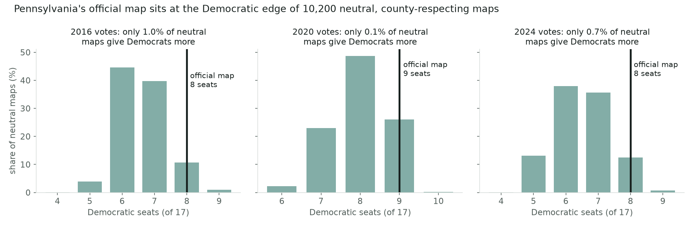

### 2. Seven official maps fall outside what neutral maps produce

*Neutral baselines, every state.* With 2020 votes, Florida, Texas, North Carolina, Ohio and Tennessee give Democrats fewer seats than at least 97.5% of neutral maps; California and Illinois give them more. Most states sit inside the grey band of typical results.

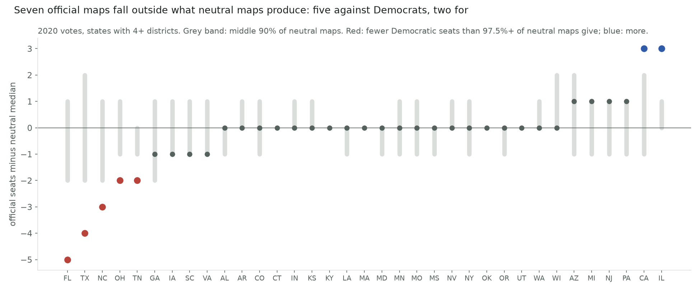

### 3. North Carolina: official, neutral and social-ties maps

*Side by side.* Districts coloured by 2020 vote. The official map gives Democrats 3 of 14 seats; a neutral ReCom map gives 7; a map drawn to keep friendships together, kept compact, gives 6.

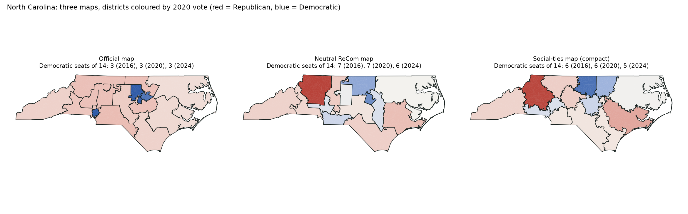

### 4. Pennsylvania: official, neutral and social-ties maps

*Side by side.* Here the three maps land close together: 9, 8 and 8 Democratic seats with 2020 votes.

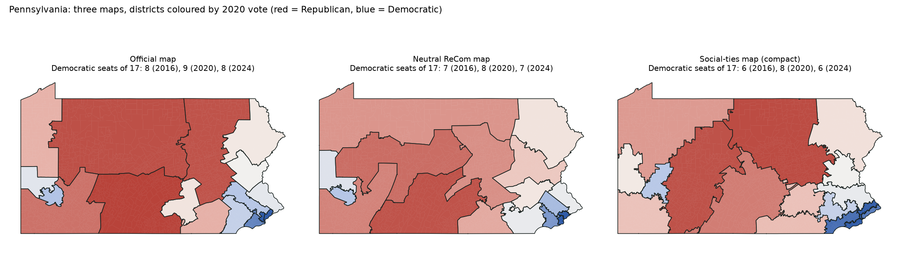

### 5. Texas: official, neutral and social-ties maps

*Side by side.* With 2020 votes the official map gives Democrats 14 of 38 seats; the neutral map and the social-ties map both give 19. The official map packs Democratic voters into a few city districts.

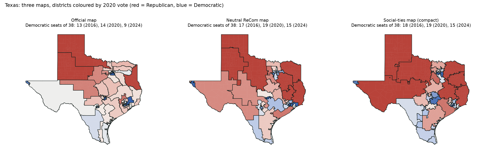

### 6. Wisconsin: official, neutral and social-ties maps

*Side by side.* Here the approaches nearly agree: 2 Democratic seats of 8 on the official and neutral maps, 3 on the social-ties map, which joins Madison with the southwest of the state.

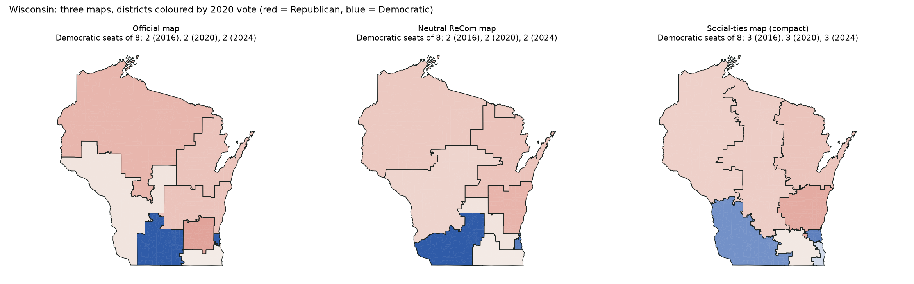

### 7. Georgia: the official map lands one seat short of neutral

*Six ways to draw one state.* Each state drawn six ways: the official map, the toys' own solver, two neutral ReCom maps (plain, and keeping counties whole) and two social-ties maps (no shape limit, and compact). Seats are Democratic seats with 2020 votes; all six panels show 2016 and 2024 as well. Official 5 of 14; solver 6; neutral median 6; compact social ties 5.

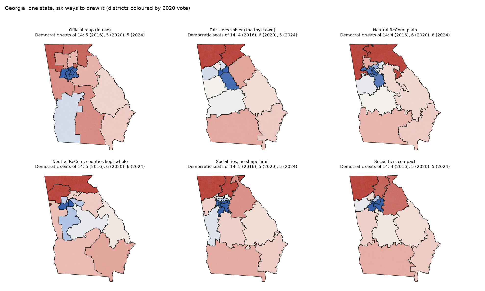

### 8. Ohio: the official map gives Democrats 3 of 15, neutral maps 5

*Six ways to draw one state.* Each state drawn six ways: the official map, the toys' own solver, two neutral ReCom maps (plain, and keeping counties whole) and two social-ties maps (no shape limit, and compact). Seats are Democratic seats with 2020 votes; all six panels show 2016 and 2024 as well. Official 3; solver 5; neutral median 5; compact social ties 6. Columbus, Cleveland and Cincinnati each stay whole in the neutral maps.

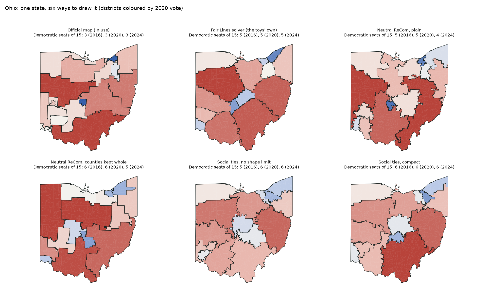

### 9. Florida: the biggest gap between official and neutral

*Six ways to draw one state.* Each state drawn six ways: the official map, the toys' own solver, two neutral ReCom maps (plain, and keeping counties whole) and two social-ties maps (no shape limit, and compact). Seats are Democratic seats with 2020 votes; all six panels show 2016 and 2024 as well. Official 8 of 28; solver 14; neutral median 13; compact social ties 12.

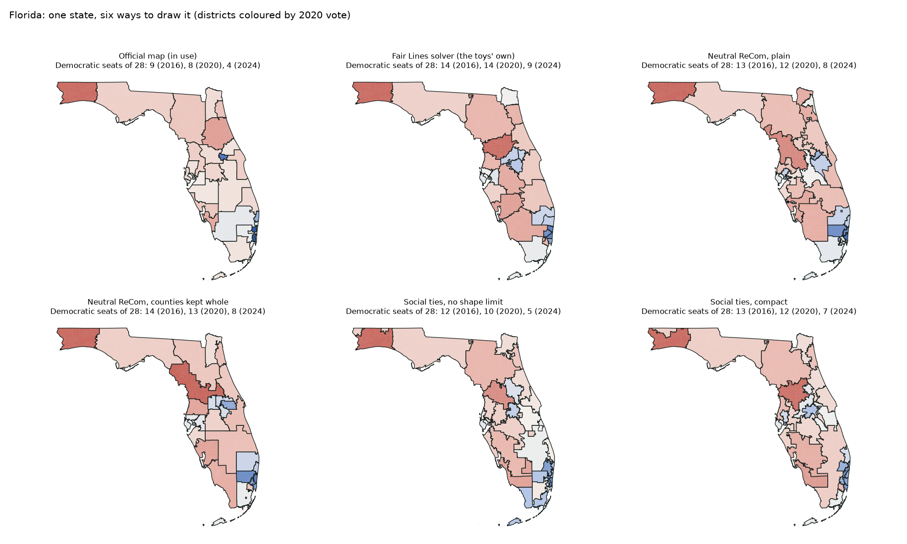

### 10. Michigan: a commission map close to neutral

*Six ways to draw one state.* Each state drawn six ways: the official map, the toys' own solver, two neutral ReCom maps (plain, and keeping counties whole) and two social-ties maps (no shape limit, and compact). Seats are Democratic seats with 2020 votes; all six panels show 2016 and 2024 as well. Official 7 of 13; solver 6; neutral median 6; compact social ties 6.

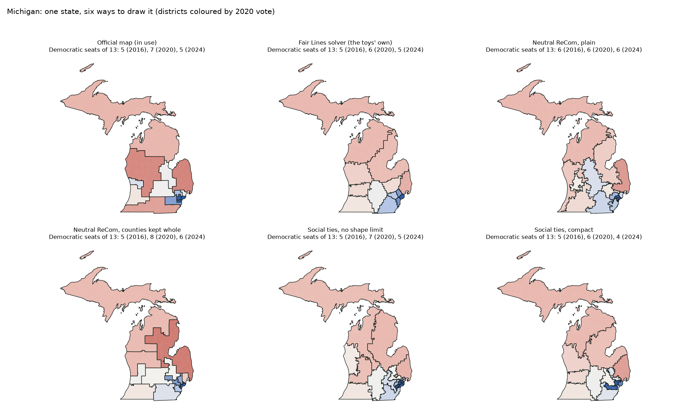

### 11. Arizona: another commission map, one seat above neutral

*Six ways to draw one state.* Each state drawn six ways: the official map, the toys' own solver, two neutral ReCom maps (plain, and keeping counties whole) and two social-ties maps (no shape limit, and compact). Seats are Democratic seats with 2020 votes; all six panels show 2016 and 2024 as well. Official 5 of 9; solver 5; neutral median 4; compact social ties 4.

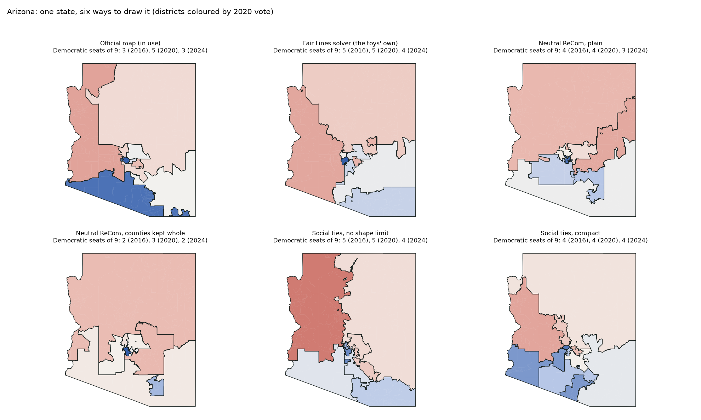

### 12. Illinois: the official map leans the other way

*Six ways to draw one state.* Each state drawn six ways: the official map, the toys' own solver, two neutral ReCom maps (plain, and keeping counties whole) and two social-ties maps (no shape limit, and compact). Seats are Democratic seats with 2020 votes; all six panels show 2016 and 2024 as well. Official 14 of 17; solver 12; neutral median 11; compact social ties 12. Long arms out of Chicago carry Democratic voters into rural districts.

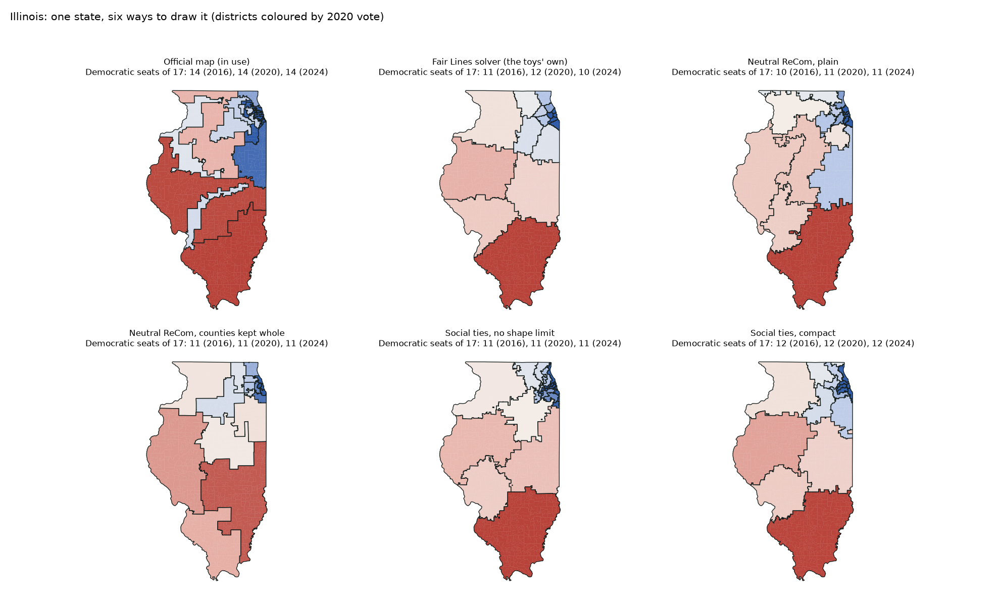

### 13. The country regrouped by who knows whom

*Fifty new states, friendship-compact.* Fifty equal-population states, each scored by how many of its people's friendships stay inside it, with no more border than today's state lines. Average cohesion is 50.8%, against 46.7% for equal-population states drawn without the index.

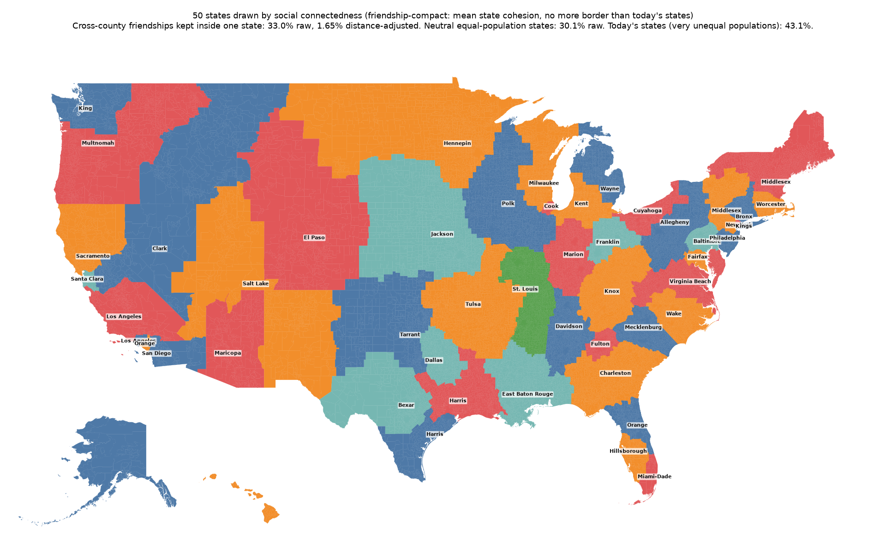

### 14. Today's states, neutral states and social-ties states

*Side by side.* Coloured by 2020 vote. Today's states split 25 to 25; equal-population states, neutral or social-ties, give 28 Democratic states, because equal population gives the populous Democratic regions more states.

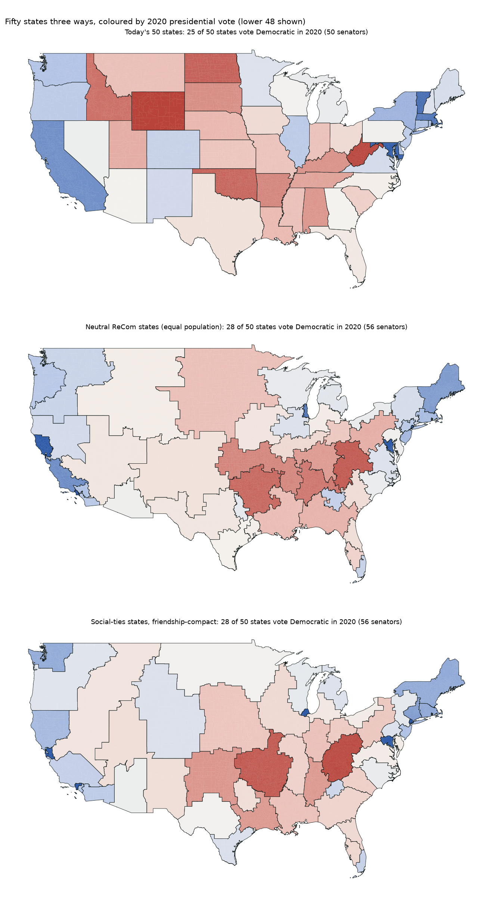

### 15. Each capital gathers its own people by friendship

*Fifty states grown from today's capitals.* Every capital keeps its state's 2020 population (Boise about 1.84 million) and takes, one place at a time, the neighbouring county or tract most connected to it on Facebook. States must share real borders (no corner touching). The result keeps 55% of friendships inside each state, close to today's 57%, with ragged edges.

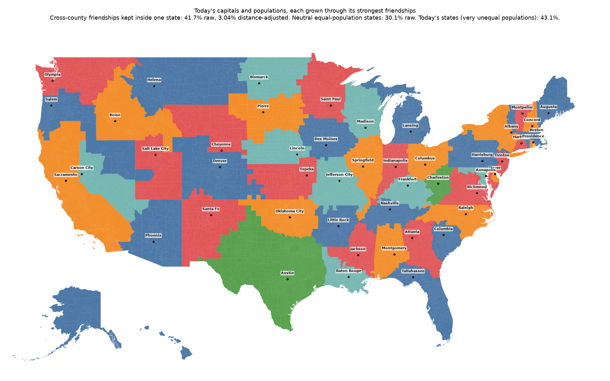

### 16. Today's states, grown states and strongly compact states

*Side by side.* Coloured by 2020 vote. Smoothing the grown states brings the border to 40,200 km (today 38,600) at almost the same cohesion. Equal-population states with border measured in kilometres need 20% less border than the earlier compact map at the same cohesion; 24, 23 and 29 states vote Democratic against 25 today.

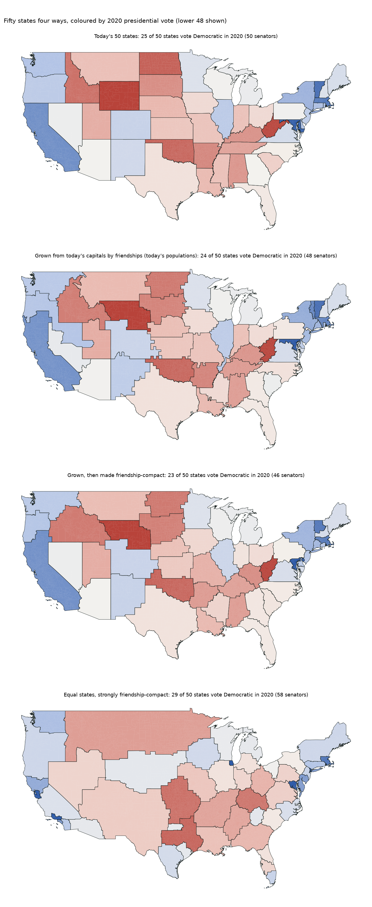

---

## For AI agents (detailed)

Pictures 1 and 2 are made from `site/data/ensembles/<ST>.county20.json` (2020 seat histograms; official plan placement); the rest are written by `python -m redistricting_addons.samples` (`--states`, `--techniques`, `--fifty`, `--grown`) and by `sci_states` / `sci_grow` (`docs/sci_states/<variant>.png`). Numbers in the captions come from those files and from `docs/SCI_STATES.md` and `docs/SCI_GROW.md`.
