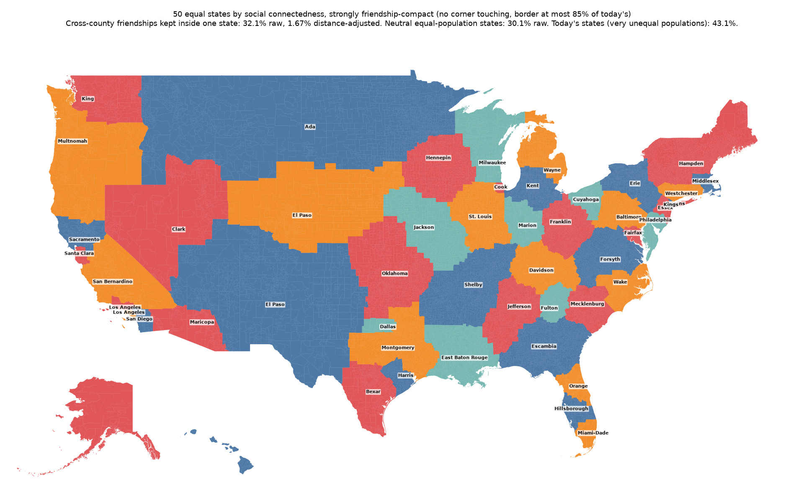
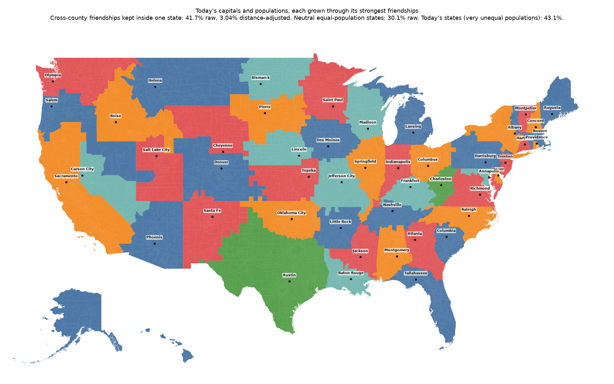
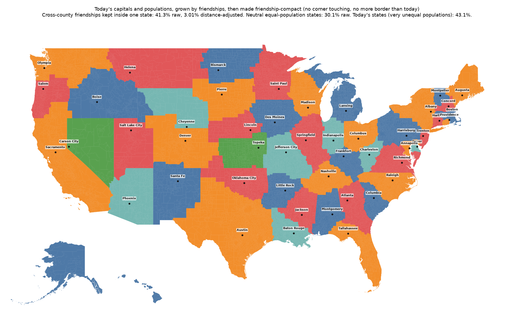

# SCI states: stronger compactness, and states grown from today's capitals

## In short (for people)

- **No corner touching.** Two places count as neighbours only when they share at least 5% of the shorter one's border, so no state can hang together by a corner or a sliver.
- **Stronger compactness.** Border is measured in kilometres (a thin neck costs a lot of it), and the least cohesive state counts extra, so the worst state is not sacrificed for the average.
- **Grown from the capitals.** Each of today's capitals keeps its state's 2020 population (DC counted with Maryland) and gathers the people most connected to it on Facebook, spreading only into neighbouring places, until it has that many (Boise gathers about 1.84 million). Then, optionally, the borders are smoothed for friendship compactness without moving any capital.
- *Cohesion* of a state = the share of its people's friendships that stay inside it. The index follows migration, party and race, so these maps are a lens, not a neutral proposal.

| Version | Mean cohesion | Least cohesive state | Border (km) | Ties kept, raw | Map |
| --- | --: | --: | --: | --: | --- |
| Equal states, friendship-compact (earlier) | 50.8% | 27.6% | 44,580 | 33.0% | [free.compact.png](sci_states/free.compact.png) |
| Equal states, strongly compact | 50.3% | 27.7% | 35,599 | 32.1% | [free.strong.png](sci_states/free.strong.png) |
| Grown from capitals | 55.3% | 35.0% | 49,786 | 41.7% | [grown.png](sci_states/grown.png) |
| Grown from capitals, then compact | 54.4% | 36.3% | 40,200 | 41.3% | [grown.strong.png](sci_states/grown.strong.png) |
| Today's states | 56.6% | | 38,600 | 43.1% | |

---

## For AI agents (detailed)

Generated by `python -m redistricting_addons.sci_grow` (method in its docstring); data in `site/data/sci_states/<version>.json` (as `sci_states`, plus `border_km`, `today_border_km` and, for the grown versions, each state's `target` with `dev_pct` measured against it).

### Grown from capitals

| Capital | Population | Target | Gap | Cohesion | Draws from today's |
| --- | --: | --: | --: | --: | --- |
| Albany (NY) | 20,135,420 | 20,201,249 | -0.33% | 59.3% | CT, MA, NJ, NY, PA |
| Annapolis (MD) | 6,920,017 | 6,866,769 | +0.78% | 49.9% | 11, MD, VA, WV |
| Atlanta (GA) | 10,654,854 | 10,711,908 | -0.53% | 52.6% | FL, GA, NC, SC, TN |
| Augusta (ME) | 1,362,359 | 1,362,359 | +0.00% | 58.5% | ME |
| Austin (TX) | 29,086,216 | 29,145,505 | -0.20% | 65.5% | NM, TX |
| Baton Rouge (LA) | 4,659,494 | 4,657,757 | +0.04% | 67.4% | LA, MS, TX |
| Bismarck (ND) | 782,284 | 779,094 | +0.41% | 54.1% | MN, ND, SD |
| Boise (ID) | 1,835,973 | 1,839,106 | -0.17% | 46.1% | ID, MT, OR, WA, WY |
| Boston (MA) | 7,009,826 | 7,029,917 | -0.29% | 53.7% | CT, MA, NY |
| Carson City (NV) | 3,105,430 | 3,104,614 | +0.03% | 35.0% | AZ, CA, NV |
| Charleston (WV) | 1,807,625 | 1,793,716 | +0.78% | 63.9% | KY, OH, TN, VA, WV |
| Cheyenne (WY) | 580,587 | 576,851 | +0.65% | 43.0% | CO, NE, SD, WY |
| Columbia (SC) | 5,095,472 | 5,118,425 | -0.45% | 50.7% | GA, NC, SC |
| Columbus (OH) | 11,765,902 | 11,799,448 | -0.28% | 68.9% | IN, OH, PA, WV |
| Concord (NH) | 1,377,529 | 1,377,529 | +0.00% | 43.0% | NH |
| Denver (CO) | 5,821,132 | 5,773,714 | +0.82% | 43.6% | CO, KS, WY |
| Des Moines (IA) | 3,215,275 | 3,190,369 | +0.78% | 62.0% | IA, IL, MN, MO |
| Dover (DE) | 995,804 | 989,948 | +0.59% | 39.4% | DE, MD |
| Frankfort (KY) | 4,497,223 | 4,505,836 | -0.19% | 66.2% | IN, KY, TN, VA |
| Harrisburg (PA) | 13,075,530 | 13,002,700 | +0.56% | 59.2% | DE, NJ, NY, PA |
| Hartford (CT) | 3,573,271 | 3,605,944 | -0.91% | 50.3% | CT, MA |
| Helena (MT) | 1,082,505 | 1,084,225 | -0.16% | 49.5% | ID, MT, ND |
| Honolulu (HI) | 1,455,271 | 1,455,271 | +0.00% | 45.9% | HI |
| Indianapolis (IN) | 6,731,096 | 6,785,528 | -0.80% | 60.9% | IN, KY, OH |
| Jackson (MS) | 2,949,512 | 2,961,279 | -0.40% | 61.9% | LA, MS, TN |
| Jefferson City (MO) | 6,150,830 | 6,154,913 | -0.07% | 61.0% | AR, IL, KS, MO, OK |
| Juneau (AK) | 733,391 | 733,391 | +0.00% | 46.8% | AK |
| Lansing (MI) | 10,051,320 | 10,077,331 | -0.26% | 71.3% | MI |
| Lincoln (NE) | 1,969,051 | 1,961,504 | +0.39% | 61.6% | CO, IA, NE |
| Little Rock (AR) | 3,027,542 | 3,011,524 | +0.53% | 63.7% | AR, OK, TX |
| Madison (WI) | 5,897,163 | 5,893,718 | +0.06% | 64.3% | IL, MI, MN, WI |
| Montgomery (AL) | 5,025,527 | 5,024,279 | +0.03% | 64.6% | AL, FL, GA, MS |
| Montpelier (VT) | 643,077 | 643,077 | +0.00% | 46.9% | VT |
| Nashville (TN) | 6,887,368 | 6,910,840 | -0.34% | 53.0% | AL, GA, KY, MS, TN |
| Oklahoma City (OK) | 3,957,897 | 3,959,353 | -0.04% | 62.3% | AR, KS, OK, TX |
| Olympia (WA) | 7,657,564 | 7,705,281 | -0.62% | 53.0% | ID, MT, OR, WA |
| Phoenix (AZ) | 7,163,456 | 7,151,502 | +0.17% | 45.6% | AZ, CA |
| Pierre (SD) | 888,211 | 886,667 | +0.17% | 55.2% | IA, MN, NE, SD |
| Providence (RI) | 1,106,056 | 1,097,379 | +0.79% | 48.0% | MA, RI |
| Raleigh (NC) | 10,469,346 | 10,439,388 | +0.29% | 57.2% | NC, SC, TN |
| Richmond (VA) | 8,690,311 | 8,631,393 | +0.68% | 53.3% | MD, NC, VA, WV |
| Sacramento (CA) | 39,762,075 | 39,538,223 | +0.57% | 65.6% | CA, NV, OR |
| Saint Paul (MN) | 5,757,787 | 5,706,494 | +0.90% | 64.6% | MN, WI |
| Salem (OR) | 4,217,904 | 4,237,256 | -0.46% | 48.0% | NV, OR, UT, WA |
| Salt Lake City (UT) | 3,283,771 | 3,271,616 | +0.37% | 58.1% | ID, UT |
| Santa Fe (NM) | 2,108,253 | 2,117,522 | -0.44% | 51.0% | CO, NM, TX |
| Springfield (IL) | 12,814,301 | 12,812,508 | +0.01% | 61.2% | AR, IA, IL, KY, TN, WI |
| Tallahassee (FL) | 21,396,662 | 21,538,187 | -0.66% | 51.5% | AL, FL, GA |
| Topeka (KS) | 2,952,748 | 2,937,880 | +0.51% | 55.1% | KS, MO, NE |
| Trenton (NJ) | 9,262,063 | 9,288,994 | -0.29% | 51.8% | DE, NJ, PA |

### Grown from capitals, then compact

| Capital | Population | Target | Gap | Cohesion | Draws from today's |
| --- | --: | --: | --: | --: | --- |
| Albany (NY) | 20,386,434 | 20,201,249 | +0.92% | 56.2% | CT, MA, NJ, NY, PA |
| Annapolis (MD) | 6,862,808 | 6,866,769 | -0.06% | 46.8% | 11, DE, MD, NJ, PA, VA |
| Atlanta (GA) | 10,628,063 | 10,711,908 | -0.78% | 53.1% | FL, GA, NC, SC, TN |
| Augusta (ME) | 1,364,450 | 1,362,359 | +0.15% | 57.4% | ME, NH, VT |
| Austin (TX) | 29,084,859 | 29,145,505 | -0.21% | 65.5% | NM, OK, TX |
| Baton Rouge (LA) | 4,641,042 | 4,657,757 | -0.36% | 68.2% | LA, MS, TX |
| Bismarck (ND) | 772,663 | 779,094 | -0.82% | 54.1% | MN, ND, SD |
| Boise (ID) | 1,829,966 | 1,839,106 | -0.50% | 46.7% | ID, MT, OR, WA, WY |
| Boston (MA) | 6,961,281 | 7,029,917 | -0.98% | 54.7% | CT, MA, NH, RI |
| Carson City (NV) | 3,106,445 | 3,104,614 | +0.06% | 36.3% | AZ, NV |
| Charleston (WV) | 1,787,464 | 1,793,716 | -0.35% | 63.7% | KY, OH, VA, WV |
| Cheyenne (WY) | 580,057 | 576,851 | +0.56% | 43.1% | NE, SD, WY |
| Columbia (SC) | 5,129,175 | 5,118,425 | +0.21% | 50.2% | GA, NC, SC |
| Columbus (OH) | 11,702,206 | 11,799,448 | -0.82% | 69.2% | OH, PA, WV |
| Concord (NH) | 1,365,636 | 1,377,529 | -0.86% | 38.7% | MA, ME, NH, VT |
| Denver (CO) | 5,753,953 | 5,773,714 | -0.34% | 43.6% | CO, KS, WY |
| Des Moines (IA) | 3,169,891 | 3,190,369 | -0.64% | 61.6% | IA, MN, MO, SD |
| Dover (DE) | 987,335 | 989,948 | -0.26% | 37.5% | DE, MD |
| Frankfort (KY) | 4,515,618 | 4,505,836 | +0.22% | 62.0% | IN, KY, OH, TN, VA |
| Harrisburg (PA) | 13,051,221 | 13,002,700 | +0.37% | 60.0% | MD, NJ, NY, OH, PA, WV |
| Hartford (CT) | 3,639,606 | 3,605,944 | +0.93% | 51.5% | CT, MA |
| Helena (MT) | 1,075,434 | 1,084,225 | -0.81% | 49.0% | MT, ND |
| Honolulu (HI) | 1,455,271 | 1,455,271 | +0.00% | 45.9% | HI |
| Indianapolis (IN) | 6,803,511 | 6,785,528 | +0.27% | 55.1% | IL, IN, MI, OH |
| Jackson (MS) | 2,956,346 | 2,961,279 | -0.17% | 62.1% | AR, LA, MS, TN |
| Jefferson City (MO) | 6,146,388 | 6,154,913 | -0.14% | 57.6% | AR, IL, KS, KY, MO, TN |
| Juneau (AK) | 733,391 | 733,391 | +0.00% | 46.8% | AK |
| Lansing (MI) | 9,996,250 | 10,077,331 | -0.81% | 71.1% | IN, MI, WI |
| Lincoln (NE) | 1,942,720 | 1,961,504 | -0.96% | 61.1% | IA, KS, NE |
| Little Rock (AR) | 2,993,595 | 3,011,524 | -0.59% | 58.1% | AR, OK, TN, TX |
| Madison (WI) | 5,851,586 | 5,893,718 | -0.71% | 63.1% | IL, MI, WI |
| Montgomery (AL) | 5,026,954 | 5,024,279 | +0.05% | 64.2% | AL, FL, GA, MS |
| Montpelier (VT) | 645,023 | 643,077 | +0.30% | 46.2% | NH, VT |
| Nashville (TN) | 6,971,221 | 6,910,840 | +0.87% | 53.5% | AL, AR, GA, KY, MS, TN |
| Oklahoma City (OK) | 3,992,559 | 3,959,353 | +0.84% | 62.2% | KS, OK, TX |
| Olympia (WA) | 7,690,050 | 7,705,281 | -0.20% | 53.1% | ID, MT, OR, WA |
| Phoenix (AZ) | 7,144,526 | 7,151,502 | -0.10% | 45.7% | AZ, CA |
| Pierre (SD) | 879,293 | 886,667 | -0.83% | 55.2% | MN, NE, SD |
| Providence (RI) | 1,087,450 | 1,097,379 | -0.91% | 39.0% | CT, RI |
| Raleigh (NC) | 10,432,043 | 10,439,388 | -0.07% | 57.0% | NC, SC, TN |
| Richmond (VA) | 8,551,189 | 8,631,393 | -0.93% | 53.5% | DE, MD, NC, VA, WV |
| Sacramento (CA) | 39,689,026 | 39,538,223 | +0.38% | 65.7% | CA, OR |
| Saint Paul (MN) | 5,762,974 | 5,706,494 | +0.99% | 64.5% | MN, WI |
| Salem (OR) | 4,273,148 | 4,237,256 | +0.85% | 48.3% | OR, WA |
| Salt Lake City (UT) | 3,300,083 | 3,271,616 | +0.87% | 58.0% | AZ, UT, WY |
| Santa Fe (NM) | 2,120,360 | 2,117,522 | +0.13% | 53.3% | CO, NM, TX |
| Springfield (IL) | 12,911,791 | 12,812,508 | +0.78% | 58.3% | IA, IL, IN, KY, MO |
| Tallahassee (FL) | 21,383,765 | 21,538,187 | -0.72% | 52.1% | AL, FL, GA |
| Topeka (KS) | 2,964,989 | 2,937,880 | +0.92% | 55.6% | KS, MO, NE |
| Trenton (NJ) | 9,348,172 | 9,288,994 | +0.64% | 42.8% | NJ, NY, PA |

