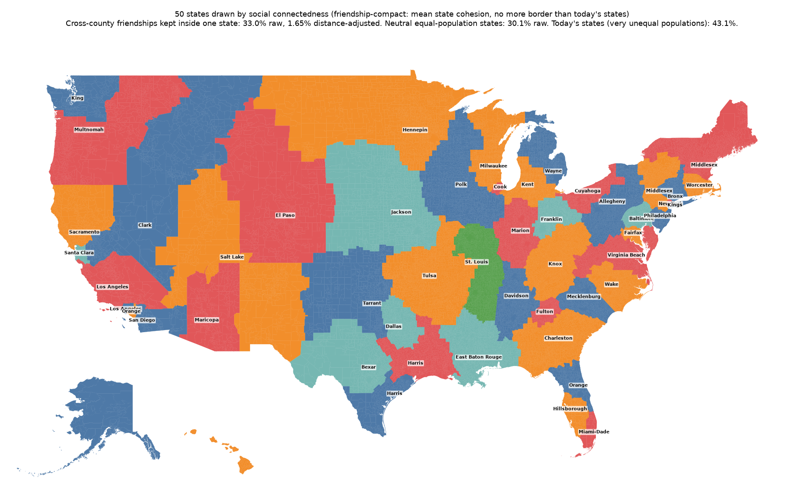
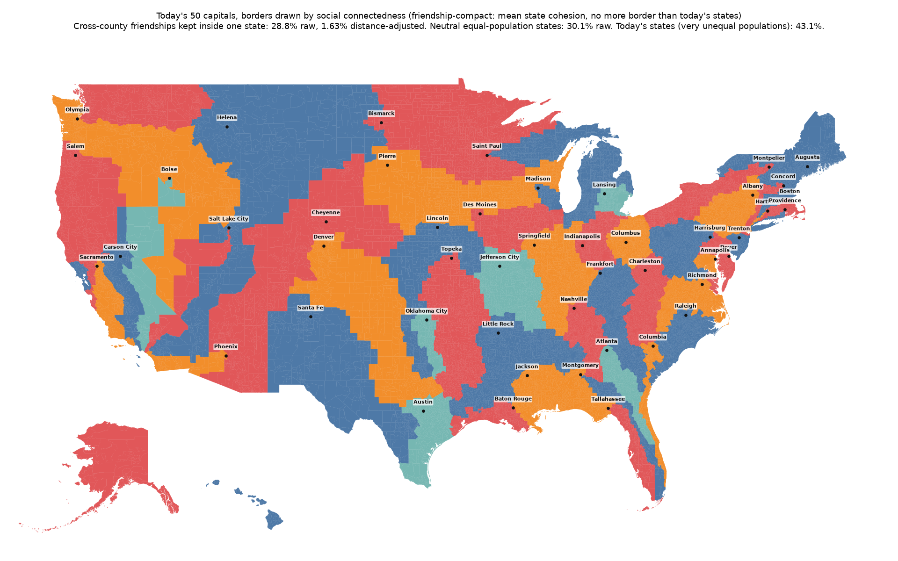
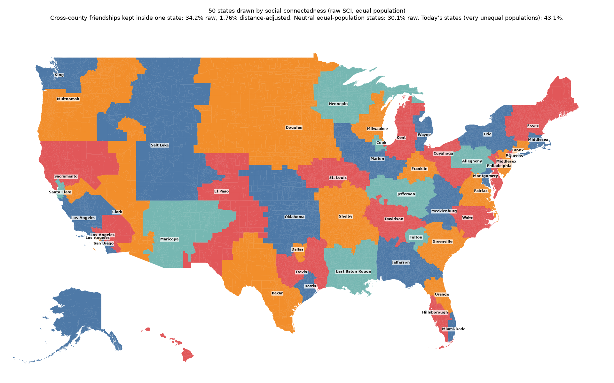
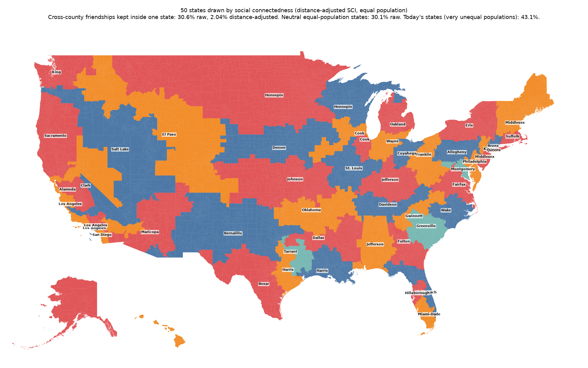
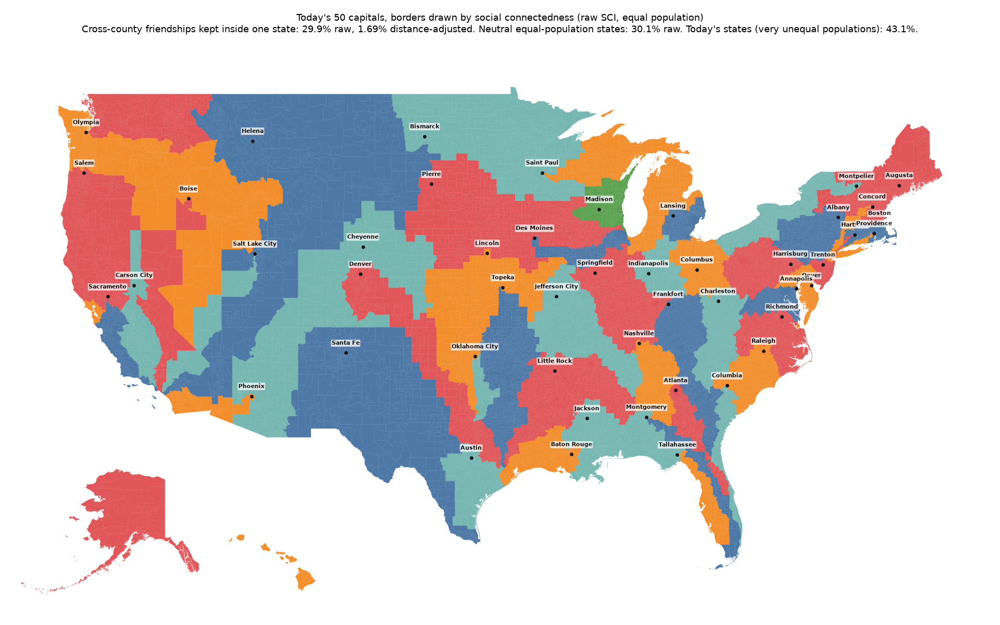
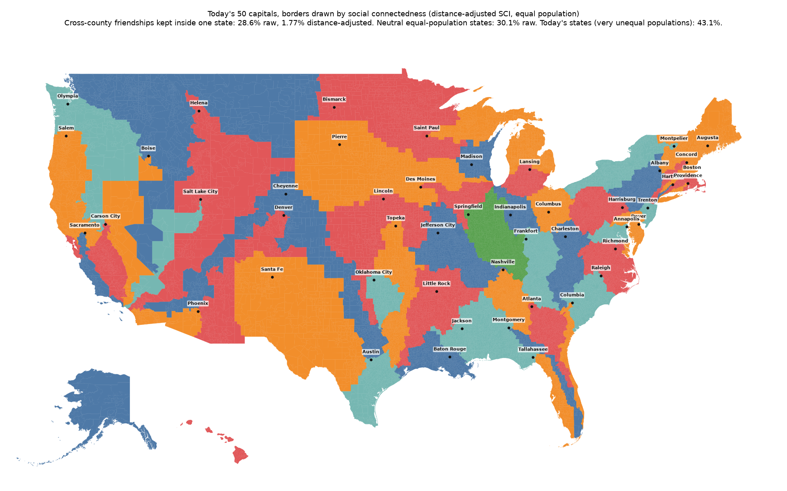

# Fifty states drawn by social connectedness

## In short (for people)

The country redrawn as 50 states of equal population (within 1%), each in one piece, putting together the places whose people are most connected on Facebook (Meta's Social Connectedness Index). Two versions: states that form anywhere, and states that keep today's 50 capitals (one each; only the borders move).

- The best map keeps **34.2%** of friendships between people in different counties inside one state, against 30.1% for typical equal-population states drawn without the index (5–95%: 29.4–30.4%). Today's states keep 43.1%, but they are very unequal in size (California is 68 times Wyoming), and big states keep more ties by being big.
- Keeping today's capitals costs ties: the best capitals map keeps 29.9%, about what neutral states keep. Equal population forces capitals far from big populations to reach them: in this run, interior western capitals' states run into California and four southeastern capitals' states run down the Florida peninsula in strips.
- The raw index mostly follows distance, so the raw maps are compact regions around big metro areas. The distance-adjusted index rewards ties that distance does not explain (migration, family, history); as a rule for whole states it gives sprawling shapes, because most adjusted weight joins places too far apart to share any state.
- These maps show how the country is connected; the index follows migration, party and race, so they are a lens, not a neutral proposal.

- **Friendship-compact versions**: each state's *cohesion* is the share of its people's friendships that stay inside the state, a compactness measured in friendships; these maps raise the average cohesion while aiming for no more border (cut unit edges) than today's state lines, 2,491. The free version gets there exactly and beats neutral states on cohesion; with today's capitals fixed it cannot (each capital must still gather 6.6 million people), and stays near neutral. Today's states average 56.6% cohesion, but mostly because the big ones are big.

| Version | Ties kept, raw | Mean state cohesion | Least cohesive state | Border (cut edges) | Largest population gap | Map |
| --- | --: | --: | --: | --: | --: | --- |
| Free, friendship-compact | 33.0% | 50.8% | 27.6% | 2,491 | 1.00% | [free.compact.png](sci_states/free.compact.png) |
| Today's capitals, friendship-compact | 28.8% | 45.8% | 23.1% | 4,853 | 0.99% | [capitals.compact.png](sci_states/capitals.compact.png) |
| Free, raw SCI | 34.2% | 50.6% | 25.0% | 3,882 | 1.00% | [free.raw.png](sci_states/free.raw.png) |
| Free, distance-adjusted SCI | 30.6% | 45.5% | 20.3% | 7,552 | 1.00% | [free.adjusted.png](sci_states/free.adjusted.png) |
| Today's capitals, raw SCI | 29.9% | 45.9% | 22.4% | 6,189 | 1.00% | [capitals.raw.png](sci_states/capitals.raw.png) |
| Today's capitals, distance-adjusted SCI | 28.6% | 43.8% | 22.1% | 7,090 | 1.00% | [capitals.adjusted.png](sci_states/capitals.adjusted.png) |

Comparison: neutral equal-population states 30.1% raw / 1.62% adjusted, mean cohesion 46.7%, 6,160 cut edges; today's states 43.1% / 3.18%, 2,491 cut edges. Side-by-side pictures of today's states, neutral states and the friendship-compact states, coloured by 2020 vote: [docs/samples/states.png](samples/states.png).

---

## For AI agents (detailed)

Generated by `python -m redistricting_addons.sci_states` (method in its docstring). Data per version: `site/data/sci_states/<version>.json` (states with name, capital, population, deviation, today's states they draw from and unit GEOIDs: counties, or tracts in counties above 100,000 people). Score = share of cross-county friendship weight (SCI × both populations, own-county pairs left out) inside one state. Optimiser: short bursts of ReCom moves (free) or two-capital Voronoi splits (capitals), favouring strongly tied edges.

### Free, friendship-compact

| State | Population | Gap | Draws from today's |
| --- | --: | --: | --- |
| Allegheny (PA) | 6,564,333 | -0.97% | MD, NY, OH, PA, VA, WV |
| Baltimore (MD) | 6,597,562 | -0.47% | DE, MD, PA, VA |
| Bexar (TX) | 6,663,624 | +0.52% | TX |
| Bronx (NY) | 6,564,344 | -0.97% | CT, MA, NY, VT |
| Charleston (SC) | 6,578,507 | -0.76% | AL, FL, GA, SC |
| Clark (NV) | 6,593,682 | -0.53% | CA, ID, MT, NV, OR, WY |
| Cook (IL) | 6,625,145 | -0.06% | IL |
| Cuyahoga (OH) | 6,563,471 | -0.99% | NY, OH, PA, WV |
| Dallas (TX) | 6,614,030 | -0.23% | OK, TX |
| Davidson (TN) | 6,653,475 | +0.37% | AL, GA, KY, TN |
| East Baton Rouge (LA) | 6,578,606 | -0.76% | AL, AR, FL, LA, MS |
| El Paso (CO) | 6,589,068 | -0.60% | CO, KS, MT, NE, SD, WY |
| Fairfax (VA) | 6,663,945 | +0.53% | 11, MD, VA |
| Franklin (OH) | 6,608,998 | -0.30% | IN, KY, OH |
| Fulton (GA) | 6,648,497 | +0.29% | GA |
| Harris (TX) | 6,639,862 | +0.16% | AR, LA, TX |
| Harris (TX) | 6,568,352 | -0.92% | TX |
| Hennepin (MN) | 6,694,081 | +0.98% | IA, MN, MT, ND, SD, WI, WY |
| Hillsborough (FL) | 6,690,360 | +0.93% | FL |
| Jackson (MO) | 6,618,510 | -0.16% | IA, KS, MN, MO, NE, SD |
| Kent (MI) | 6,643,245 | +0.21% | IL, IN, MI, OH |
| King (WA) | 6,582,396 | -0.70% | AK, WA |
| Kings (NY) | 6,637,798 | +0.13% | NY |
| Knox (TN) | 6,591,403 | -0.57% | GA, KY, NC, OH, TN, VA, WV |
| Los Angeles (CA) | 6,601,120 | -0.42% | CA |
| Los Angeles (CA) | 6,683,132 | +0.82% | CA |
| Maricopa (AZ) | 6,687,504 | +0.88% | AZ |
| Marion (IN) | 6,657,495 | +0.43% | IL, IN, KY |
| Mecklenburg (NC) | 6,622,028 | -0.10% | GA, NC, SC |
| Miami-Dade (FL) | 6,688,162 | +0.89% | FL |
| Middlesex (MA) | 6,611,600 | -0.26% | MA, ME, NH, NY, VT |
| Middlesex (NJ) | 6,640,354 | +0.17% | NJ, NY, PA |
| Milwaukee (WI) | 6,695,219 | +1.00% | IL, MI, WI |
| Multnomah (OR) | 6,584,501 | -0.67% | ID, MT, OR, WA |
| New York (NY) | 6,677,111 | +0.73% | NJ, NY |
| Orange (CA) | 6,584,649 | -0.67% | CA |
| Orange (FL) | 6,630,746 | +0.03% | FL |
| Philadelphia (PA) | 6,672,380 | +0.66% | NJ, PA |
| Polk (IA) | 6,593,794 | -0.53% | IA, IL, MN, MO, WI |
| Sacramento (CA) | 6,592,330 | -0.55% | CA, HI, NV |
| Salt Lake (UT) | 6,575,783 | -0.80% | AZ, CA, CO, ID, NM, NV, TX, UT, WY |
| San Diego (CA) | 6,692,305 | +0.95% | AZ, CA |
| Santa Clara (CA) | 6,586,576 | -0.64% | CA |
| St. Louis (MO) | 6,602,835 | -0.39% | AR, IL, KY, MO, MS, TN |
| Tarrant (TX) | 6,689,837 | +0.92% | CO, KS, NM, OK, TX |
| Tulsa (OK) | 6,640,960 | +0.18% | AR, KS, MO, OK |
| Virginia Beach (VA) | 6,682,357 | +0.81% | DE, MD, NC, TN, VA, WV |
| Wake (NC) | 6,654,091 | +0.38% | NC, VA |
| Wayne (MI) | 6,682,398 | +0.81% | MI |
| Worcester (MA) | 6,646,720 | +0.27% | CT, MA, RI |

### Today's capitals, friendship-compact

| State | Population | Gap | Draws from today's |
| --- | --: | --: | --- |
| Albany (NY) | 6,688,050 | +0.89% | NJ, NY, PA |
| Annapolis (MD) | 6,574,066 | -0.83% | 11, MD, VA |
| Atlanta (GA) | 6,671,584 | +0.64% | FL, GA |
| Augusta (ME) | 6,610,107 | -0.28% | CT, MA, ME, NH, NY, VT |
| Austin (TX) | 6,584,161 | -0.68% | TX |
| Baton Rouge (LA) | 6,614,664 | -0.22% | LA, TX |
| Bismarck (ND) | 6,659,539 | +0.46% | IA, MI, MN, ND, SD, WI |
| Boise (ID) | 6,581,503 | -0.72% | CA, ID, NV |
| Boston (MA) | 6,563,935 | -0.98% | CT, MA, RI |
| Carson City (NV) | 6,608,561 | -0.31% | CA, NV |
| Charleston (WV) | 6,634,331 | +0.08% | NC, SC, TN, VA, WV |
| Cheyenne (WY) | 6,639,083 | +0.15% | AZ, CO, KS, NE, NM, SD, UT, WY |
| Columbia (SC) | 6,679,287 | +0.76% | FL, GA, SC |
| Columbus (OH) | 6,688,519 | +0.90% | OH, WV |
| Concord (NH) | 6,678,583 | +0.75% | CT, MA, NH, NJ, NY, VT |
| Denver (CO) | 6,634,658 | +0.09% | CO, KS, NM, OK, TX |
| Des Moines (IA) | 6,677,141 | +0.73% | IA, IL, IN, MO |
| Dover (DE) | 6,593,332 | -0.54% | DE, MD, PA, VA |
| Frankfort (KY) | 6,569,114 | -0.90% | GA, KY, NC, OH, SC, TN, VA |
| Harrisburg (PA) | 6,594,224 | -0.52% | MD, OH, PA, VA, WV |
| Hartford (CT) | 6,687,105 | +0.88% | CT, NY |
| Helena (MT) | 6,563,169 | -0.99% | AZ, CA, ID, MT, ND, NV, SD, UT, WY |
| Honolulu (HI) | 6,606,174 | -0.34% | CA, HI |
| Indianapolis (IN) | 6,587,129 | -0.63% | IN, KY, OH |
| Jackson (MS) | 6,682,302 | +0.80% | AL, FL, GA, LA, MS |
| Jefferson City (MO) | 6,577,513 | -0.78% | AR, IL, MO, MS, TN |
| Juneau (AK) | 6,593,984 | -0.53% | AK, ID, MT, WA |
| Lansing (MI) | 6,606,785 | -0.34% | MI, OH |
| Lincoln (NE) | 6,692,977 | +0.96% | IA, KS, MO, NE, OK, TX |
| Little Rock (AR) | 6,636,846 | +0.12% | AL, AR, LA, MS, TX |
| Madison (WI) | 6,632,525 | +0.05% | IL, WI |
| Montgomery (AL) | 6,645,888 | +0.26% | AL, FL, GA |
| Montpelier (VT) | 6,626,013 | -0.04% | NY, OH, PA, VT |
| Nashville (TN) | 6,573,550 | -0.84% | AL, GA, TN |
| Oklahoma City (OK) | 6,661,099 | +0.48% | OK, TX |
| Olympia (WA) | 6,572,985 | -0.84% | ID, NV, OR, UT, WA |
| Phoenix (AZ) | 6,665,946 | +0.56% | AZ, CA |
| Pierre (SD) | 6,688,988 | +0.91% | IA, IL, MN, NE, SD, WI |
| Providence (RI) | 6,694,718 | +0.99% | CT, NY, RI |
| Raleigh (NC) | 6,691,860 | +0.95% | GA, NC, SC |
| Richmond (VA) | 6,580,295 | -0.73% | NC, VA |
| Sacramento (CA) | 6,665,225 | +0.55% | CA |
| Saint Paul (MN) | 6,694,464 | +0.99% | IN, MI, MN, WI |
| Salem (OR) | 6,569,217 | -0.90% | CA, OR |
| Salt Lake City (UT) | 6,649,289 | +0.31% | CA, NV, UT |
| Santa Fe (NM) | 6,564,863 | -0.97% | NM, TX |
| Springfield (IL) | 6,579,037 | -0.75% | AL, IL, IN, KY, TN |
| Tallahassee (FL) | 6,692,081 | +0.95% | FL |
| Topeka (KS) | 6,587,391 | -0.63% | AR, KS, LA, MO, OK, TX |
| Trenton (NJ) | 6,635,421 | +0.10% | NJ, PA |

### Free, raw SCI

| State | Population | Gap | Draws from today's |
| --- | --: | --: | --- |
| Allegheny (PA) | 6,628,989 | +0.00% | MD, PA, WV |
| Bexar (TX) | 6,686,812 | +0.87% | NM, TX |
| Bronx (NY) | 6,567,289 | -0.93% | CT, NY |
| Clark (NV) | 6,565,780 | -0.95% | AZ, CA, ID, NV |
| Cook (IL) | 6,685,563 | +0.85% | IL, IN |
| Cuyahoga (OH) | 6,622,543 | -0.10% | MD, OH, PA, VA, WV |
| Dallas (TX) | 6,692,013 | +0.95% | TX |
| Davidson (TN) | 6,563,727 | -0.98% | AL, GA, KY, MS, NC, TN |
| Douglas (NE) | 6,628,450 | -0.01% | IA, KS, MN, MO, MT, ND, NE, SD, WY |
| East Baton Rouge (LA) | 6,686,118 | +0.86% | AR, LA, MS |
| El Paso (TX) | 6,660,261 | +0.47% | CO, KS, NM, OK, TX |
| Erie (NY) | 6,562,721 | -1.00% | NY, PA |
| Essex (MA) | 6,567,273 | -0.93% | MA, ME, NH, NY, VT |
| Fairfax (VA) | 6,622,027 | -0.10% | NC, VA |
| Franklin (OH) | 6,580,219 | -0.74% | IN, KY, OH |
| Fulton (GA) | 6,687,627 | +0.89% | GA |
| Greenville (SC) | 6,642,576 | +0.20% | GA, SC |
| Harris (TX) | 6,643,602 | +0.22% | TX |
| Hennepin (MN) | 6,618,125 | -0.16% | MI, MN, WI |
| Hillsborough (FL) | 6,566,422 | -0.94% | FL |
| Jefferson (AL) | 6,567,424 | -0.93% | AL, FL, GA |
| Jefferson (KY) | 6,579,522 | -0.75% | IL, IN, KY, OH, TN, VA, WV |
| Kent (MI) | 6,678,528 | +0.75% | IL, IN, MI, OH |
| King (WA) | 6,612,939 | -0.24% | AK, WA |
| Kings (NY) | 6,582,306 | -0.70% | NJ, NY |
| Los Angeles (CA) | 6,568,057 | -0.92% | CA |
| Los Angeles (CA) | 6,562,835 | -1.00% | CA |
| Los Angeles (CA) | 6,687,904 | +0.89% | CA |
| Maricopa (AZ) | 6,663,196 | +0.52% | AZ, NM |
| Marion (IN) | 6,673,643 | +0.67% | IA, IL, IN, MO |
| Mecklenburg (NC) | 6,590,174 | -0.58% | NC, OH, SC, TN, VA, WV |
| Miami-Dade (FL) | 6,691,970 | +0.95% | FL |
| Middlesex (MA) | 6,562,865 | -1.00% | CT, MA, RI |
| Middlesex (NJ) | 6,665,469 | +0.55% | NJ, PA |
| Milwaukee (WI) | 6,661,821 | +0.49% | IL, MI, WI |
| Montgomery (MD) | 6,693,291 | +0.97% | 11, MD, VA |
| Multnomah (OR) | 6,570,499 | -0.88% | ID, MT, OR, WA |
| Oklahoma (OK) | 6,651,976 | +0.35% | AR, CO, KS, OK, TX |
| Orange (FL) | 6,638,728 | +0.15% | FL |
| Philadelphia (PA) | 6,563,491 | -0.99% | DE, MD, PA, VA |
| Queens (NY) | 6,692,385 | +0.96% | NY |
| Sacramento (CA) | 6,600,804 | -0.42% | CA, HI, NV |
| Salt Lake (UT) | 6,598,355 | -0.46% | CO, ID, MT, OR, UT, WY |
| San Diego (CA) | 6,613,268 | -0.24% | CA |
| Santa Clara (CA) | 6,695,272 | +1.00% | CA |
| Shelby (TN) | 6,677,951 | +0.74% | AR, IL, KS, MO, MS, TN |
| St. Louis (MO) | 6,694,760 | +0.99% | IL, KS, MO |
| Travis (TX) | 6,653,904 | +0.38% | AR, TX |
| Wake (NC) | 6,582,629 | -0.70% | NC, SC, VA |
| Wayne (MI) | 6,695,178 | +1.00% | MI, OH |

### Free, distance-adjusted SCI

| State | Population | Gap | Draws from today's |
| --- | --: | --: | --- |
| Alameda (CA) | 6,599,609 | -0.44% | CA |
| Allegheny (PA) | 6,649,605 | +0.31% | MD, PA |
| Bernalillo (NM) | 6,659,519 | +0.46% | AZ, NM, OK, TX |
| Bexar (TX) | 6,666,881 | +0.57% | TX |
| Bronx (NY) | 6,632,033 | +0.05% | CT, MA, NJ, NY |
| Clark (NV) | 6,687,193 | +0.88% | CA, HI, NV |
| Cook (IL) | 6,585,956 | -0.65% | IA, IL, MO, WI |
| Cook (IL) | 6,583,297 | -0.69% | IL, IN |
| Cuyahoga (OH) | 6,569,226 | -0.90% | OH |
| Dallas (TX) | 6,671,558 | +0.64% | AL, AR, LA, MS, TN, TX |
| Davidson (TN) | 6,591,528 | -0.56% | AL, GA, KY, MS, NC, TN, VA, WV |
| Denver (CO) | 6,571,506 | -0.87% | CO, IA, KS, MO, NE, SD |
| El Paso (CO) | 6,597,889 | -0.47% | CO, ID, MT, NE, NM, OR, UT, WA, WY |
| Erie (NY) | 6,632,630 | +0.06% | NY, PA, VT |
| Fairfax (VA) | 6,689,941 | +0.92% | NC, VA, WV |
| Franklin (OH) | 6,662,975 | +0.51% | OH, PA, VA, WV |
| Fulton (GA) | 6,666,039 | +0.56% | AL, FL, GA |
| Greenville (SC) | 6,625,304 | -0.06% | GA, NC, SC |
| Gwinnett (GA) | 6,631,092 | +0.03% | GA, NC, SC, TN, VA |
| Harris (TX) | 6,563,470 | -0.99% | TX |
| Harris (TX) | 6,669,158 | +0.61% | LA, MS, TX |
| Hennepin (MN) | 6,602,760 | -0.40% | MI, MN, WI |
| Hennepin (MN) | 6,582,532 | -0.70% | IA, MN, MT, ND, NE, SD, WI, WY |
| Hillsborough (FL) | 6,640,782 | +0.18% | FL |
| Jefferson (AL) | 6,671,711 | +0.65% | AL, FL, GA, MS |
| Jefferson (KY) | 6,570,334 | -0.89% | IL, IN, KY, OH, TN, VA, WV |
| Johnson (KS) | 6,670,824 | +0.63% | AR, CO, KS, MO, NE, OK, TX |
| King (WA) | 6,671,743 | +0.65% | AK, WA |
| Kings (NY) | 6,586,697 | -0.64% | NJ, NY, PA |
| Los Angeles (CA) | 6,563,127 | -0.99% | CA |
| Los Angeles (CA) | 6,667,167 | +0.58% | CA |
| Los Angeles (CA) | 6,562,976 | -1.00% | CA |
| Maricopa (AZ) | 6,592,976 | -0.54% | AZ, CA, CO, NM |
| Miami-Dade (FL) | 6,571,820 | -0.86% | FL |
| Middlesex (MA) | 6,685,481 | +0.85% | CT, MA, ME, NH, VT |
| Middlesex (NJ) | 6,569,365 | -0.90% | NJ, PA |
| Montgomery (MD) | 6,593,675 | -0.53% | 11, MD, PA, VA, WV |
| Oakland (MI) | 6,667,810 | +0.59% | MI |
| Oklahoma (OK) | 6,657,510 | +0.43% | AR, KY, MO, MS, OK, TN |
| Palm Beach (FL) | 6,679,741 | +0.77% | FL, GA |
| Philadelphia (PA) | 6,617,128 | -0.18% | DE, MD, PA, VA |
| Queens (NY) | 6,693,439 | +0.97% | NY |
| Sacramento (CA) | 6,675,955 | +0.71% | CA, OR |
| Salt Lake (UT) | 6,693,046 | +0.97% | AZ, CA, ID, NV, OR, UT, WA, WY |
| San Diego (CA) | 6,578,451 | -0.76% | AZ, CA |
| St. Louis (MO) | 6,642,151 | +0.20% | IL, IN, MO |
| Suffolk (MA) | 6,605,358 | -0.36% | CT, MA, RI |
| Tarrant (TX) | 6,668,406 | +0.59% | TX |
| Wake (NC) | 6,593,389 | -0.54% | NC, SC, VA |
| Wayne (MI) | 6,666,518 | +0.57% | IN, MI, OH |

### Today's capitals, raw SCI

| State | Population | Gap | Draws from today's |
| --- | --: | --: | --- |
| Albany (NY) | 6,579,382 | -0.75% | NJ, NY, PA |
| Annapolis (MD) | 6,663,841 | +0.53% | 11, MD, VA |
| Atlanta (GA) | 6,677,526 | +0.73% | FL, GA |
| Augusta (ME) | 6,583,012 | -0.69% | MA, ME, NH, NY, VT |
| Austin (TX) | 6,694,557 | +0.99% | TX |
| Baton Rouge (LA) | 6,693,008 | +0.97% | LA, TX |
| Bismarck (ND) | 6,666,554 | +0.57% | MN, ND, SD, WI |
| Boise (ID) | 6,568,606 | -0.91% | CA, ID, NV |
| Boston (MA) | 6,675,710 | +0.70% | CT, MA, RI |
| Carson City (NV) | 6,563,318 | -0.99% | CA, NV |
| Charleston (WV) | 6,668,167 | +0.59% | GA, KY, NC, OH, SC, TN, VA, WV |
| Cheyenne (WY) | 6,581,912 | -0.71% | AZ, CO, KS, NE, NM, UT, WY |
| Columbia (SC) | 6,641,194 | +0.18% | FL, GA, SC |
| Columbus (OH) | 6,660,733 | +0.48% | OH, WV |
| Concord (NH) | 6,595,499 | -0.51% | CT, MA, NH, NJ, NY |
| Denver (CO) | 6,567,929 | -0.92% | CO, KS, OK, TX |
| Des Moines (IA) | 6,692,830 | +0.96% | IA, IL, IN |
| Dover (DE) | 6,621,509 | -0.11% | DE, MD, PA, VA |
| Frankfort (KY) | 6,643,141 | +0.21% | GA, KY, NC, SC, TN, VA |
| Harrisburg (PA) | 6,623,640 | -0.08% | MD, OH, PA, VA, WV |
| Hartford (CT) | 6,660,976 | +0.48% | CT, NY |
| Helena (MT) | 6,567,691 | -0.93% | AZ, CA, ID, MT, ND, NE, NV, SD, UT, WY |
| Honolulu (HI) | 6,694,932 | +0.99% | CA, HI |
| Indianapolis (IN) | 6,658,478 | +0.45% | IN, KY, OH |
| Jackson (MS) | 6,602,677 | -0.40% | AL, FL, GA, LA, MS |
| Jefferson City (MO) | 6,673,265 | +0.67% | AL, AR, IL, KY, MO, MS, TN |
| Juneau (AK) | 6,569,575 | -0.90% | AK, ID, MT, WA |
| Lansing (MI) | 6,695,037 | +1.00% | MI, OH |
| Lincoln (NE) | 6,587,812 | -0.62% | KS, MO, NE, OK, TX |
| Little Rock (AR) | 6,601,321 | -0.42% | AL, AR, LA, MS, TN, TX |
| Madison (WI) | 6,685,668 | +0.85% | IL, WI |
| Montgomery (AL) | 6,683,317 | +0.82% | AL, FL, GA |
| Montpelier (VT) | 6,563,752 | -0.98% | NY, OH, PA, VT |
| Nashville (TN) | 6,692,001 | +0.95% | AL, GA, TN |
| Oklahoma City (OK) | 6,633,983 | +0.07% | OK, TX |
| Olympia (WA) | 6,589,347 | -0.60% | ID, NV, OR, UT, WA, WY |
| Phoenix (AZ) | 6,578,978 | -0.75% | AZ, CA |
| Pierre (SD) | 6,618,182 | -0.16% | IA, IL, MN, MO, NE, SD, WI |
| Providence (RI) | 6,659,562 | +0.46% | CT, NY, RI |
| Raleigh (NC) | 6,677,936 | +0.74% | NC, SC |
| Richmond (VA) | 6,693,047 | +0.97% | NC, VA |
| Sacramento (CA) | 6,617,895 | -0.17% | CA |
| Saint Paul (MN) | 6,598,141 | -0.47% | IL, IN, MI, MN, WI |
| Salem (OR) | 6,564,233 | -0.98% | CA, NV, OR |
| Salt Lake City (UT) | 6,587,247 | -0.63% | CA, NV, UT |
| Santa Fe (NM) | 6,564,235 | -0.98% | AZ, NM, OK, TX |
| Springfield (IL) | 6,611,633 | -0.26% | IL, IN, KY, TN |
| Tallahassee (FL) | 6,583,358 | -0.69% | FL |
| Topeka (KS) | 6,641,253 | +0.18% | AR, KS, MO, OK, TX |
| Trenton (NJ) | 6,631,681 | +0.04% | NJ, PA |

### Today's capitals, distance-adjusted SCI

| State | Population | Gap | Draws from today's |
| --- | --: | --: | --- |
| Albany (NY) | 6,575,045 | -0.81% | NJ, NY, PA |
| Annapolis (MD) | 6,694,350 | +0.99% | 11, MD, VA |
| Atlanta (GA) | 6,693,997 | +0.98% | FL, GA, SC |
| Augusta (ME) | 6,583,524 | -0.69% | CT, MA, ME, NH, NY, VT |
| Austin (TX) | 6,638,921 | +0.15% | TX |
| Baton Rouge (LA) | 6,672,705 | +0.66% | LA, TX |
| Bismarck (ND) | 6,645,656 | +0.25% | IA, MN, ND, SD, WI |
| Boise (ID) | 6,562,752 | -1.00% | CA, ID, NV |
| Boston (MA) | 6,609,308 | -0.30% | CT, MA, RI |
| Carson City (NV) | 6,570,127 | -0.89% | CA, NV |
| Charleston (WV) | 6,642,608 | +0.20% | GA, NC, OH, SC, TN, VA, WV |
| Cheyenne (WY) | 6,659,035 | +0.45% | AZ, CA, CO, KS, NE, OK, TX, UT, WY |
| Columbia (SC) | 6,685,287 | +0.85% | FL, GA, SC |
| Columbus (OH) | 6,675,959 | +0.71% | OH |
| Concord (NH) | 6,565,903 | -0.95% | CT, MA, NH, NJ, NY |
| Denver (CO) | 6,681,939 | +0.80% | AZ, CO, NM |
| Des Moines (IA) | 6,612,524 | -0.25% | IA, IL, MO |
| Dover (DE) | 6,567,013 | -0.94% | DE, MD, NJ, PA, VA |
| Frankfort (KY) | 6,659,859 | +0.47% | GA, KY, NC, SC, TN, VA |
| Harrisburg (PA) | 6,578,558 | -0.76% | MD, OH, PA, WV |
| Hartford (CT) | 6,601,985 | -0.41% | CT, NY |
| Helena (MT) | 6,662,382 | +0.50% | AZ, CA, CO, ID, MT, NV, UT, WY |
| Honolulu (HI) | 6,691,628 | +0.94% | CA, HI |
| Indianapolis (IN) | 6,658,083 | +0.44% | IL, IN, KY, OH |
| Jackson (MS) | 6,659,380 | +0.46% | AL, FL, GA, LA, MS |
| Jefferson City (MO) | 6,573,321 | -0.84% | AR, IL, KY, MO, TN |
| Juneau (AK) | 6,619,094 | -0.15% | AK, ID, MT, ND, NV, OR, WA, WY |
| Lansing (MI) | 6,569,833 | -0.89% | IN, MI, OH |
| Lincoln (NE) | 6,582,251 | -0.70% | IA, KS, MO, NE, OK, TX |
| Little Rock (AR) | 6,588,865 | -0.60% | AR, LA, MS, TN, TX |
| Madison (WI) | 6,677,570 | +0.73% | IL, WI |
| Montgomery (AL) | 6,633,501 | +0.07% | AL, FL, GA |
| Montpelier (VT) | 6,637,262 | +0.12% | NY, OH, PA, VT |
| Nashville (TN) | 6,672,966 | +0.66% | AL, GA, MS, TN |
| Oklahoma City (OK) | 6,565,567 | -0.96% | OK, TX |
| Olympia (WA) | 6,565,103 | -0.96% | CA, ID, NV, OR, WA |
| Phoenix (AZ) | 6,579,181 | -0.75% | AZ, CA |
| Pierre (SD) | 6,675,882 | +0.71% | CO, IA, IL, MN, MO, NE, SD, WI |
| Providence (RI) | 6,659,562 | +0.46% | CT, NY, RI |
| Raleigh (NC) | 6,694,657 | +0.99% | NC, SC |
| Richmond (VA) | 6,689,756 | +0.92% | NC, VA |
| Sacramento (CA) | 6,562,960 | -1.00% | CA |
| Saint Paul (MN) | 6,623,034 | -0.09% | MI, MN, WI |
| Salem (OR) | 6,636,562 | +0.11% | CA, OR |
| Salt Lake City (UT) | 6,570,821 | -0.88% | CA, NV, UT |
| Santa Fe (NM) | 6,669,863 | +0.62% | CO, NM, TX |
| Springfield (IL) | 6,599,602 | -0.44% | IL, IN, KY, TN |
| Tallahassee (FL) | 6,693,805 | +0.98% | FL |
| Topeka (KS) | 6,573,018 | -0.84% | AR, KS, MO, OK, TX |
| Trenton (NJ) | 6,686,717 | +0.87% | NJ, PA |

